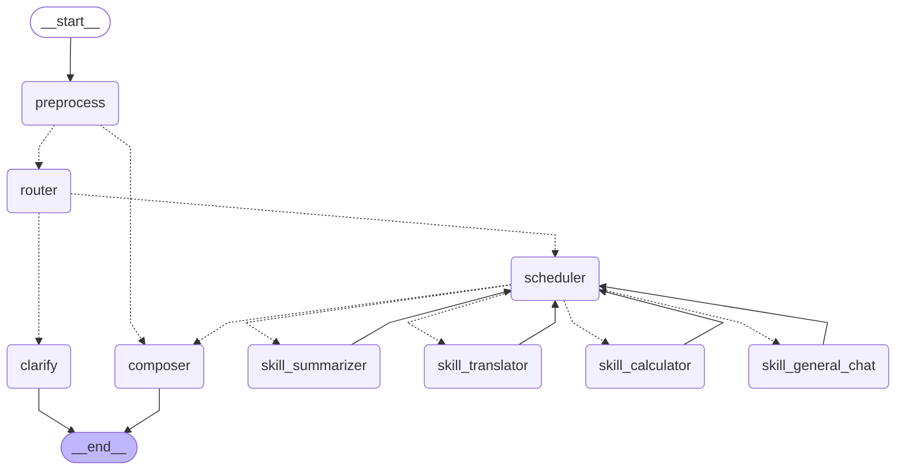

# skillagent — a multi-skill CLI agent (English / Persian)

`skillagent` is a command-line prototype of a multi-skill LLM agent. A free-form prompt in English, Persian (فارسی), a mix of both or Finglish is routed to **up to 2** of exactly **4 skills**: `summarizer`, `translator`, `calculator` and `general_chat`. The flow is a [LangGraph](https://github.com/langchain-ai/langgraph) graph. A router node produces a **Pydantic-validated mini-plan** (at most 2 steps). A deterministic scheduler then runs the plan's steps **in parallel or chained**, depending on whether one step needs another's output. The calculator never lets the LLM do arithmetic: the model calls a tool, and a **safe AST evaluator** computes the exact result. The model is **Qwen3.8-27B** (27B dense, ≤ 35B) on the **Groq free tier**. The interface is a CLI (REPL plus one-shot `ask`), with no web API.

> **Status (2026-11-27):** feature-complete, with 1 292 offline tests. Final test-set numbers are filled in at [Evaluation → Results](#test-set-results).

## Contents
1. [Quick start](#1-quick-start)
2. [Model and provider](#2-model-and-provider)
3. [Graph architecture](#3-graph-architecture)
4. [Multi-skill strategy](#4-multi-skill-strategy-chain-vs-parallel)
5. [Fallback and ambiguity](#5-fallback-and-ambiguity)
6. [Calculator](#6-calculator)
7. [Prompt engineering](#7-prompt-engineering)
8. [Evaluation](#8-evaluation)
9. [Persian handling](#9-persian-handling)
10. [Scalability](#10-scalability-to-20-skills)
11. [Known limitations and production gaps](#11-known-limitations-and-production-gaps)
12. [Assumptions](#12-assumptions)
13. [Development process and AI usage](#13-development-process-and-ai-usage)
14. [Repository layout](#14-repository-layout)
15. [Requirement checklist](#15-requirement-checklist)

Design documents with more detail: [`docs/ARCHITECTURE.md`](docs/ARCHITECTURE.md), [`docs/DECISIONS.md`](docs/DECISIONS.md) (ADR-001…030), [`docs/CONTRACTS.md`](docs/CONTRACTS.md), [`docs/REQUIREMENTS.md`](docs/REQUIREMENTS.md).

---

## 1. Quick start

### Prerequisites
| What | Why | Get it |
|---|---|---|
| **uv** | Package and project manager. It installs **Python 3.12** for you (pinned in `.python-version`) | Windows: `powershell -ExecutionPolicy ByPass -c "irm https://astral.sh/uv/install.ps1 \| iex"` · macOS/Linux: `curl -LsSf https://astral.sh/uv/install.sh \| sh` |
| **git** | To clone the repository | https://git-scm.com |
| **A free Groq API key** | The LLM provider. No payment method is needed | https://console.groq.com/keys |

### Install and configure — Windows (PowerShell)
```powershell
git clone https://github.com/leavetrace/multi-skill-agent.git multi-skill-agent
cd multi-skill-agent
uv sync                                  # creates .venv with Python 3.12 and all dependencies
Copy-Item .env.example .env
notepad .env                             # set GROQ_API_KEY=gsk_...   then save
uv run python -m skillagent doctor       # offline config check; prints the masked key
```
> Notepad may save the file as `.env.txt`. Check with `Get-ChildItem -Force .env*`; the file must be named exactly `.env`. The file is git-ignored.

### Install and configure — macOS / Linux
```bash
git clone https://github.com/leavetrace/multi-skill-agent.git multi-skill-agent
cd multi-skill-agent
uv sync
cp .env.example .env && "${EDITOR:-nano}" .env     # set GROQ_API_KEY=gsk_...
uv run python -m skillagent doctor
```

`doctor --live` additionally makes 2 real LLM calls to check provider access.

### Use it
```powershell
# Interactive session (REPL): type a request, then an empty line to send it.
# `:paste` … `:end` for text with blank lines, `:quit` to exit.
uv run python -m skillagent

# One request
uv run python -m skillagent ask "What is the capital of Australia?"
uv run python -m skillagent ask "What is 15% of 2,480?"                 # arithmetic fast path, 0 LLM calls
uv run python -m skillagent ask "این جمله را به انگلیسی ترجمه کن: هوا امروز خیلی خوب است."
uv run python -m skillagent ask "۲۵ درصد از ۸۴۰ چند می‌شود؟"            # → ۲۱۰, 0 LLM calls
# Parallel: two independent tasks in one request
uv run python -m skillagent ask "Translate 'Where is the train station?' into German and calculate 15% of 240."
# Chain: long text from a file; step 2 works on step 1's output
#   request.txt:  Summarize this text and translate the summary into Persian:
#                 <paste the article here>
uv run python -m skillagent ask --file request.txt --out answer.md

# Inspection
uv run python -m skillagent ask "2+2" --trace      # routing decision, steps, trace events
uv run python -m skillagent ask "2+2" --json       # full AgentRun as JSON (UTF-8, not escaped)
uv run python -m skillagent graph --mermaid        # the graph, generated from the skill registry
```

| `ask` option | Effect |
|---|---|
| `--file, -f PATH` | Read the request from a UTF-8 file (long or multi-line text) |
| `--out, -o PATH` | Also write the response to a UTF-8 file (LF line endings) |
| `--trace` | Print the routing decision, the step table and trace events. Also shows provider retry warnings, which are hidden otherwise |
| `--json` | Print the full `AgentRun` (decision, results, trace, timings, call count) |

> **Persian on the Windows console.** UTF-8 is forced for console I/O, so characters are never garbled. Still, Windows Terminal and `cmd` do not do right-to-left (bidi) layout: Persian lines may show in left-to-right order. To read Persian answers properly, use `--out answer.md` and open the file in an editor (VS Code, Notepad). For long Persian input, use `--file`.

### Tests and evaluation
```powershell
uv run pytest -q                  # 1 292 offline tests; never touches the network (FakeLLM)
uv run ruff check .
uv run python -m eval.runner --set dev --dry-run                    # rendered prompts, 0 calls
uv run python -m eval.runner --set dev --cases D01,D05 --label try  # live (uses free quota)
uv run python -m eval.runner --set test --i-know-this-is-the-test-set --runs 3 --label final
```
Reports go to `eval/reports/<set>_<date>_<label>.md`. All runner options are in [`eval/README.md`](eval/README.md).

### Docker (optional)
```powershell
docker build -t skillagent .
docker run --rm -it --env-file .env skillagent                       # REPL
docker run --rm --env-file .env skillagent ask "What is 15% of 2,480?"
```
The image is `python:3.12-slim` plus uv, with `uv sync --frozen --no-dev`. The key is passed at run time with `--env-file` and is never copied into the image (`.dockerignore` excludes `.env`).

---

## 2. Model and provider

| | |
|---|---|
| **Provider** | **Groq** free tier (OpenAI-compatible endpoint; no payment method) |
| **Model** | **`qwen/qwen3.8-27b`**: Qwen3.8-27B, **27B parameters, dense** (not MoE), so "≤ 35B" holds for total parameters ([A5](#12-assumptions)) |
| Settings | Temperature 0 for the router and calculator, 0.2 translator, 0.3 summarizer, 0.7 chat. Thinking off (`reasoning_effort: "none"`) |
| Alternate (configured, documented) | Google AI Studio `gemma-4-31b-it` (30.7B dense); OpenRouter; any OpenAI-compatible endpoint. Switching is configuration only: `SKILLAGENT_LLM_PROVIDER=google` plus `GOOGLE_API_KEY` |

### How it was chosen: a measured bake-off (WP0, ADR-026)
Two free, dense, ≤ 35B candidates were run through the same budgeted script on 2026-11-26 ([`docs/handoffs/WP0_report.md`](docs/handoffs/WP0_report.md)):

| Measured | Gemma 4 31B IT (Google AI Studio) | **Qwen3.8-27B (Groq)** |
|---|---|---|
| Availability (one 35-min window) | 18 of 26 chat calls → HTTP 503 "high demand" | every call answered |
| Latency of successful calls | 8–70 s | p50 0.91 s / p95 2.12 s (routing) |
| Reasoning leakage | `<thought>…</thought>` inside `content`; no working off switch | none; `reasoning_effort: "none"` honoured |
| Routing probes (draft router prompt, 20 EN/FA probes) | not reached | 20/20 parse, schema, skill set, structure, language |
| Calculator tool-call extraction (5 EN/FA items) | not reached | 5/5 |
| Persian quality (owner's native review, 1–5) | not reached | fluency 4.3, accuracy 3.8, naturalness 3.4 |

OpenRouter `:free` models were rejected as the primary provider, because they are capped at 50 requests/day without purchased credits. That is too few for evaluation (ADR-006).

### Free-tier limits that shaped the design
| Limit (Groq free tier, `qwen/qwen3.8-27b`) | Source | Design consequence |
|---|---|---|
| **8 000 tokens/minute** | `x-ratelimit-limit-tokens` header (WP0) | The router prompt was compacted from 4 732 to ~2 293 tokens ([§7.2](#72-improvement-example-a-router-prompt-compaction)). The gateway honours `retry-after`. The eval runner paces cases by tokens used |
| **200 000 tokens/day** | 429 body, measured 2026-11-26 (ADR-029) | ~3 000 tokens per eval case → ~65 cases per day. Live work is budgeted per day, the runner can `--resume`, and the final test run gets a day of its own |
| 1 000 requests/day | `x-ratelimit-limit-requests` header (WP0) | Not binding |
| Preview model | Groq model list | Deprecation risk: the model id is configuration, and the alternate provider stays wired |

All provider access goes through one gateway (`skillagent/llm/gateway.py`, plain `openai.AsyncOpenAI`, ADR-015). It holds a global concurrency semaphore, an RPM limiter, retries with backoff and `retry-after`, `<think>`/`<thought>` stripping, and redaction of keys and account ids from errors.

---

## 3. Graph architecture

### The graph (generated: `uv run python -m skillagent graph --mermaid`)

Dotted edges are conditional. `scheduler → skill_*` is a LangGraph `Send` fan-out, and each skill node returns to the scheduler for the next wave. The four `skill_*` nodes are generated from the skill registry; no edge names a skill.

### Node by node
| Node | LLM? | What it does | Why |
|---|---|---|---|
| `preprocess` | no | Persian normalization (`ي→ی`, `ك→ک`, ZWNJ clean-up), Persian/Arabic-Indic digits mapped to ASCII in a *calculation view* (the original text is kept), script-based language hint, language-aware token estimate. An oversized input goes straight to `composer` with a polite limit message | Cheap, deterministic, testable. Never spend a call on what code can decide |
| `router` | 1 call (2 with a repair) | Candidate selection (all skills while N ≤ 12, BM25 Top-K above). Prompt **rendered from the registry**, JSON mode, Pydantic validation, one repair retry. Deterministic **fast path** for pure arithmetic (`2+2`, `۲۵ درصد از ۸۴۰`: 0 calls). Guards: G1 (a payload skill with no payload → clarify), G2 (response-language sanity) | Decides **what** runs. The output is inspectable and measurable |
| `clarify` | no | Returns the router's question in the user's language and asks them to resend the **full** request (there is no memory) | Avoids confident wrong answers |
| `scheduler` | no | Pure wave planner. Picks READY steps (dependencies satisfied), caps them at `max_parallel_steps`, `max_waves` and the request deadline, and marks dependents of failed steps `skipped`. Emits `Send(skill_<name>, StepTask)` or goes to `composer` | Decides **when**. Parallel and chained are one mechanism |
| `skill_<name>` | 0–2 calls | Generic wrapper: receives only the `StepTask`, enforces budgets and timeout (`asyncio.wait_for`), and turns every exception into `SkillResult(status=error)` | Decides **how**. Isolated, and errors don't cascade |
| `composer` | no | Assembles the answer deterministically in the response language: one output, the chain's final output, or labelled sections for parallel steps, plus partial-failure notes and the dropped-intents notice | No extra call. It never paraphrases away an exact translation or number (ADR-003) |

### The validated plan (`RoutingDecision`)
The router returns one JSON object:
```json
{"response_language": "en",
 "steps": [{"id": "s1", "skill": "summarizer", "instruction": "Summarize the article", "input_from": "user", "params": {}},
           {"id": "s2", "skill": "translator", "instruction": "Translate the summary into Persian", "input_from": "s1", "params": {"target_language": "fa"}}],
 "needs_clarification": false, "clarification_question": null, "confidence": 0.9, "rationale": "summary, then its translation"}
```
Pydantic validators enforce rules V1–V8 (`skillagent/core/types.py`, [CONTRACTS §1.1](docs/CONTRACTS.md)):

| Rule | Check |
|---|---|
| V1 / V2 | A clarification has a question and no steps; otherwise there is at least 1 step |
| V3 / V4 | Step ids are unique; `input_from` is `"user"` or an **earlier** step (acyclic by construction) |
| V5 | The skill name resolves in the registry (`"General Chat"` → `general_chat`); unknown names are an error |
| V6 | **Typed composition:** the producer's `output_kind` must be in the consumer's `accepts` set |
| V7 | `params` are validated against the skill's own params model (`target_language`, `length`, `format`, …) |
| V8 | **Skill limit in code:** steps beyond `max_skills_per_request` (2) are removed and their instructions recorded as `dropped_intents`. The model can't override this |

The router never copies the user's text into the plan (ADR-002). `instruction` is a ≤ 300-character restatement, and each skill extracts its own payload from the original prompt (`skillagent/skills/payload.py`: quoted span → after a colon → leading/trailing cue line → whole text, marked uncertain). Echoing a 2 000-word text would double tokens and latency, and the model could alter it.

### Why plan-then-execute with `Send` (ADR-001)
- The **router** decides *what*, the **scheduler** decides *when*, and the **skills** decide *how*. Each is unit-tested on its own; the scheduler is pure functions.
- **`Send` gives context isolation:** a skill node sees its `StepTask` only, never the graph state, the router's rationale or the other step's data (an integration test asserts this).
- **Adding a skill = registering one `SkillSpec`.** The router cards, the skill enum, the params docs and the graph nodes are all generated from it.

| Alternative | Why rejected |
|---|---|
| Static conditional edges plus hardcoded combination edges | O(N²) edges; no generic dependencies |
| ReAct / tool-calling loop | Unbounded iterations, no validated routing artefact, weak on small models |
| Supervisor multi-agent | An extra LLM hop per step on a free tier |
| Pure embedding classifier | Can't extract dependencies or parameters |
| LLM synthesizer as the last node | Extra call, and it can paraphrase exact outputs (kept as a future option) |

---

## 4. Multi-skill strategy (chain vs parallel)

**One rule decides: declared data dependency.** A step whose `input_from` is another step's id is **chained**, and runs in the next wave on that step's output only. Steps that read `"user"` are **independent** and run in the **same wave, concurrently** through `Send`. There is no special "summarize then translate" edge; the same scheduler runs any 2-step DAG.

| Request | Plan | Waves | Output |
|---|---|---|---|
| "Summarize this text and translate the summary into Persian: …" | `summarizer(user) → translator(s1, target_language=fa)` | `[s1]`, `[s2]` | The Persian summary only (the intermediate summary is in `--trace`) |
| "Translate 'Where is the train station?' into German and calculate 15% of 240." | `translator(user, de) + calculator(user)` | `[s1, s2]` | Two labelled sections: **Translation** `Wo ist der Bahnhof?` · **Calculation** `(15/100)*240 = 36` (live WP5 smoke; a stray period after the expression has since been fixed) |
| «این متن را خلاصه کن و بعد به انگلیسی ترجمه کن: …» | `summarizer(user) → translator(s1, en)` | `[s1]`, `[s2]` | English translation of the Persian summary |
| "Summarize this, translate it to German, and compute 3+4" | the first 2 tasks in the user's order | `[s1]`, `[s2]` | German translation of the summary + "Note: I handle up to 2 tasks per request, so I skipped: <the third task>." |

- **The limit of 2 is enforced in code, not in the prompt.** V8 trims the plan, and the scheduler caps parallelism and waves. The prompt tells the model to list *every* task in order, so code can report what it dropped instead of the model silently merging tasks. The notice is localized («توجه: من در هر درخواست حداکثر ۲ کار را انجام می‌دهم؛ …»).
- **Chains pass only the declared dependency's output** (`is_chained=True`), not the original article and not a transcript.
- **Failures don't cascade:** if step 1 fails, step 2 is marked `skipped` and never called, and the composer explains the root cause. A step that was *rejected* (e.g. "text too short") shows its own helpful message.
- Typed composition (V6) rejects plans such as "summarize the output of the calculator" before anything runs.

---

## 5. Fallback and ambiguity

Policy ADR-007 / [ARCHITECTURE §5](docs/ARCHITECTURE.md):

| Situation | Behaviour | Why |
|---|---|---|
| Small talk, general question | `general_chat` (a normal route, not a fallback) | It is a first-class skill |
| Request outside all skills ("set an alarm", "book a flight") | `general_chat` says what it can't do and what it can | Helpful, never a dead end |
| Skill clear, required input missing ("Translate this", «اینو برام ترجمه کن») | `clarify` (from the router, or guard G1 as a backstop) | Can't be guessed |
| Genuinely ambiguous with a costly wrong guess | `clarify` | Avoids confident wrong answers |
| Mildly ambiguous, a sensible default exists (target language, length) | Proceed with the default; lower `confidence` | Avoids over-clarifying |
| More than 2 intents | Run the first 2 in the user's order; notify about the rest | Spec limit, graceful UX |
| Router output invalid after 1 repair, or provider error | **Degraded mode:** `general_chat` with a degraded-mode note; a static bilingual apology if that also fails | The CLI never crashes |
| Router hit a provider quota (429) | No fallback call (it would be refused too); bilingual apology | Don't burn quota on a doomed call (ADR-029) |
| Prompt injection inside a text to summarize/translate | The user's skill runs on the text **as data** | Delimiters plus explicit prompt rules; eval cases T15 and D18 |

**Clarification without memory (A6).** The brief excludes cross-request memory, so a clarification is a **terminal** answer: it asks the question and tells the user to resend the full request with the missing detail. Over- and under-clarification are both scored in eval: `clarify` precision/recall, plus dev cases that must *not* clarify.

---

## 6. Calculator

```
request ─▶ direct path? ──yes──▶ normalize ─▶ safe AST evaluator ─▶ deterministic formatting
              │ no                                   ▲
              ▼                                      │
   LLM forced tool call  evaluate({"calculations":[{"expression","label"}]})
   (JSON-mode fallback if tool calling is unreliable; one repair on a syntax error)
```
- **The LLM never states a number.** It only turns language into expressions: "15% of 2,480" → `15/100*2480`, «بیست و پنج ضرب در چهار، منهای دوازده» → `25*4 - 12`. A forced `tool_choice` calls `evaluate`. The displayed number always comes from the evaluator, and the model's `label` can't change it.
- **Safe evaluator** (`skillagent/skills/calculator/evaluator.py`): Python `ast` parse with a **whitelist** of nodes, operators, 30 functions (`sqrt`, `log`, `sin`, `factorial`, `comb`, …) and constants (`pi`, `e`, `tau`). Validation runs before any computation, and evaluation is iterative, so input can't control recursion depth. **No `eval`, `exec` or `sympify`**; a test greps the package to enforce this.
- **Exact arithmetic:** `Fraction` wherever possible: `0.1+0.2 = 3/10`, `8**(2/3) = 4`, `log(8, 2) = 3`. Results are shown with `=` when exact, otherwise with `≈` and the exact fraction.
- **DoS guards:** expression ≤ 500 chars, ≤ 300 AST nodes, nesting ≤ 40, exponent ≤ 10 000, result ≤ 5 000 digits, `factorial(n ≤ 1000)`. Literal size is checked *before* a `Fraction` is built (`1e100000` → `too_large`). `9**9**9`, `__import__('os')` and `().__class__` are rejected in < 0.1 ms (124 security tests).
- **Direct path, 0 LLM calls:** pure expressions, with Persian digits, `×`, `÷`, `^`, `√`, `%` and thousands separators (`(3+4)*2^3 / 7`, `What is 15% of 2,480?`, `۱۲ × ۳٫۵ چند می‌شود؟`), go straight to the evaluator. The router's fast path reuses the same detector, so the two can never disagree.
- **Math errors are answers, not crashes:** `10/(5-5)` → "division by zero".
- **Persian output:** Persian digits, `٫` as the decimal mark and `٬` for thousands (`۴۰۵٬۰۰۰`). The expression stays ASCII.
- Tests: 605 offline calculator tests. Live: tool-call extraction 5/5 (WP0); the Persian word problem «مبلغ قابل پرداخت (تومان): … = ۴۰۵٬۰۰۰» was correct (WP5).

---

## 7. Prompt engineering

Prompts are versioned files (`skillagent/prompts/<skill>/v<N>.md`), loaded by `PromptLoader`. Each run records the template sha and the rendered sha. Versions can be pinned (`SKILLAGENT_PROMPT_VERSIONS=router=1,translator=2`), so v1 and v2 can be evaluated side by side. Each text-skill prompt opens with an HTML comment explaining its design; code strips it before sending.

### 7.1 Design per skill
| Prompt | Key design choices | Why (failure it prevents) |
|---|---|---|
| **Router** (`router/v1.md`) | Rendered from the registry: compact skill cards (purpose, "needs text" flag, 3 *Use* + 2 *Don't use* cues in EN and FA, one-line params). 10 numbered decision rules. 10 policy few-shots (1 full JSON, 9 in compact notation): chain, parallel, over-limit, clarify EN/FA, no-match, instruction language, Finglish, injection, "answer in Persian". JSON only, temperature 0, thinking off | Confusion between similar skills is the main routing risk, so *Don't use* cues encode the boundaries (math concept → chat, "answer in Persian" ≠ translation). Rule 1 ("every task is a step, in order") lets code, not the model, apply the 2-skill limit |
| **Summarizer** (`summarizer/v1.md`) | Length and format **decided in code** from word count (< 120 words → 1–2 sentences; < 500 → 3–5 sentences; else 5–8 bullets) and passed as one concrete sentence. Faithfulness rules: no new facts, keep names/numbers/dates, keep uncertainty, no meta-openers ("This text discusses…", «این متن درباره‌ی…»). The output language is stated explicitly. Text inside `<text>` is data | Small models follow "3–5 sentences", not "an appropriate length". These are the typical small-model failures: invented facts, dropped numbers, certainty inflation, wasted first sentences |
| **Translator** (`translator/v1.md`) | Rule 1: the text is data, so questions and commands in it are **translated, not answered** (with an injection example). Output is the translation only. An item-by-item *preserve* list (lists, markdown, URLs, code, numbers, emoji, names, idioms by meaning). A Persian section covers standard written Persian, verb-final order, ZWNJ examples (می‌شود، کتاب‌ها، بزرگ‌ترین), Persian punctuation and `ی/ک` | ≤ 35B models answer "what is 2+2?" instead of translating it and ignore a generic "preserve formatting". Code removes and **counts** residual preambles, quotes and Arabic letters (`meta.postprocess`) |
| **Calculator** (`calculator/v1.md`) | "Always call `evaluate`; never write a result". The exact expression grammar and function list, percentage patterns, a Persian number-word and operator lexicon, 4 examples | The number must come from the tool (R2). Persian number words are the hardest part of extraction |
| **General chat** (`general_chat/v1.md`) | An explicit capability boundary (no browsing, booking, alarms, files, memory) plus what the assistant *can* do. No live data, no arithmetic, ≤ ~120 words, empathy first for feelings. Persian: warm and natural, not translation-ese; Finglish gets a Persian-script reply. A degraded-mode note never mentions internals | Small models invent prices and "remember" earlier messages. Declines should come with an alternative |

Prompt-injection resistance (O4) is layered: router rule 9, `<text>` delimiters with escaping of our own tags inside user data, a "data, not instructions" rule in each payload skill, and eval cases (T15 Persian, D18). In the live WP3 samples on Groq, both injection samples were translated or summarized, not obeyed (5/5/5 in the owner's review).

### 7.2 Improvement example (a): router prompt compaction
| | Router v1 (draft) | Router v1 (compact, shipped) |
|---|---|---|
| System prompt, provider tokens | **4 732** (median, dev D01–D20) | **~2 293** (D07; median over 39 calls 2 302) |
| Dev D01–D20, plan correct (router only, 1 run, T=0) | 19/20 | **20/20** |
| Dev D01–D40, plan correct | — | 40/40 |
| p50 router latency | **36.5 s** | **0.92 s** |
| 429 rate-limit retries | on every call | none in 39 calls |

- **Problem (measured, ADR-024):** the first router prompt cost 4 732 tokens per call. With Groq's **8 000 tokens/minute** limit, every routing call waited ~35 s on a 429 `retry-after`. The prompt was accurate but unusable on the free tier.
- **What changed (WP4b, ADR-027):** 12 full-JSON few-shots replaced by 10 *policy* examples, 1 in JSON and 9 in a one-line notation (`summarizer(user) -> translator(s1, target_language=fa)`). Cue lists capped at the 3 most decisive *Use* and 2 *Don't use* lines per card, keeping both scripts. Skill-level examples dropped when a router example already covers the skill (−472 tokens). Rules merged into 10 short numbered lines. Prompt size is now pinned by a unit test.
- **Why it worked:** the dropped examples restated what cards already encoded (the Persian word problem and "what is a derivative" are both in the calculator card's cues). The live run showed no calculator/chat confusion. The one v1 miss, D16 ("Summarize this, translate it to German, and compute 3+4", where the translator ran in parallel instead of on the summary), became the correct chain.
- **Caveat:** these are **dev-set** numbers, on the set the prompt was tuned against, from one run. The reportable numbers are the test-set results in §8.

Sources: [`docs/handoffs/WP4b_report.md`](docs/handoffs/WP4b_report.md), [`docs/handoffs/WP4b_dev_smoke.md`](docs/handoffs/WP4b_dev_smoke.md), ADR-024, ADR-027.

### 7.3 Improvement example (b): text-skill prompts v1 → v2
**Method.** The owner (a native Persian speaker) scored the v1 text-skill outputs on Groq (`docs/handoffs/WP3_samples_groq_scores.md`). Each weakness became a targeted v2 change, written with *different* example words so the test would show whether the rule generalises rather than whether the model copies an answer. Then v1 and v2 were run on 8 samples and the owner scored them **blind** (A/B in random order, key opened afterwards): `docs/handoffs/WP7a_persian_review.md`, `WP7a_persian_review_key.md`, ADR-032.

**Shipped: translator v2.** Owner's finding on v1 (sample t1, naturalness 3/5): calqued English structure, «۱۲ درصد افزایش در فروش» and «این موضوع را … بحث خواهیم کرد».

v2 prompt change (excerpt from `skillagent/prompts/translator/v2.md`):
```
Write idiomatic Persian collocations and verbs, not English structure
(e.g. «کاهش ۳۰ درصدی قیمت‌ها», not «۳۰ درصد کاهش در قیمت‌ها»);
use established Persian technical terms; match the source register.
```

| | Output for "…a 12% increase in sales… We'll discuss it on Monday at 10:30." | Owner F/A/N |
|---|---|---|
| v1 | «… ۱۲ درصد افزایش در فروش است که عمدتاً در تهران و اصفهان رخ داده است. این موضوع را روز دوشنبه ساعت ۱۰:۳۰ **بحث خواهیم کرد**.» | 4 / 5 / 3 |
| v2 | «… ۱۲ درصد افزایش فروش است، عمدتاً در تهران و اصفهان. این موضوع را روز دوشنبه ساعت ۱۰:۳۰ **بررسی می‌کنیم**.» | **5 / 5 / 5** |

**Why it worked, and its limit:** the verb became natural and the sentence lost its English shape; the exact collocation «افزایش ۱۲ درصدی» still did not appear. On a technical sample (n2) the owner preferred v1, because v2 rendered "fine-tune" as «بهینه‌سازی» (less precise than «تنظیم دقیق»). Net over the two translator samples: v2 4.83 / 4.5 / 4.83 vs v1 4.17 / 5.0 / 4.0 (F / A / N).

**Rejected: summarizer v2 and general-chat v2.** The blind review preferred v1 for the summarizer in 2 of 3 samples (one fluent v2 summary gave councillor Maria Lopez the false title «شهردار», mayor) and for general chat in 3 of 3, although the engineer's own unscored reading had favoured v2 chat. They were not merged (drafts remain in git history). Lesson: fluent output with a factual error loses, and a blind native-speaker review can overturn the author's own judgement.

---

## 8. Evaluation

### Dataset design
Two hand-written YAML sets ([`eval/README.md`](eval/README.md)); source texts are original paragraphs in `eval/texts/`.

| Set | Cases | Use |
|---|---|---|
| `eval/test_set.yaml` | **15** (T01–T15) | **Reported numbers only.** Frozen at commit `926a680` before final prompt tuning; never used for tuning |
| `eval/dev_set.yaml` | 40 (D01–D40) | Prompt iteration. Broader and harder: Finglish, third-language targets, response-language traps, calculator-vs-chat traps, windowing of a ~1 600-word text, separators, over-limit, injection |

| id | lang | category | tests |
|---|---|---|---|
| T01 | en | single | Summarize an English paragraph, no preamble |
| T02 | fa | single | Summarize a formal Persian paragraph; no Arabic letters |
| T03 | en | single | Translate English → Persian (target stated) |
| T04 | fa | single | Translate colloquial Persian → English («برگردون») |
| T05 | en | single | Word problem: 30% discount then 8% tax → `64.26` |
| T06 | fa | single | Persian number words and digits: «بیست و پنج درصدِ ۳۲۰ ضرب در ۳» → `240` |
| T07 | en | single | General-knowledge question about leap years → `general_chat`, not calculator |
| T08 | fa | single | Persian small talk → `general_chat` |
| T09 | en | **chain** | Summarize, then translate the summary into Persian |
| T10 | en | **parallel** | Translate a phrase AND compute 1 250 ÷ 8 → `156.25` |
| T11 | mixed | single | Persian instruction + English article → Persian summary |
| T12 | fa | **clarify** | «اینو برام ترجمه کن» with no text → clarification |
| T13 | en | **no_match** | "Set an alarm…" → `general_chat` explains limits (`clarify` also accepted) |
| T14 | en | **over_limit** | Three tasks → first two run in parallel, one reported as dropped |
| T15 | fa | **injection** | Persian text with an embedded "ignore the above" → translated, not obeyed |

Coverage: 8 EN, 6 FA, 1 mixed; each skill alone in both languages; chain; 2 parallel plans; clarification, no-match, over-limit and injection.

**Split discipline.** Prompts are changed only by looking at dev failures. `tests/unit/eval/test_datasets.py` proves the sets don't overlap: rendered prompts, instruction wording and source texts are compared after normalizing case, Persian/Arabic letters, digits, ZWNJ and punctuation. The 20 WP0 probes that chose the model live in the dev set only. The runner refuses `--set test` without `--i-know-this-is-the-test-set`.

### Metrics (`eval/metrics.py`; measured, never estimated)
| Metric | Definition |
|---|---|
| **Routing-correct** (headline *skill-detection accuracy*) | Ordered skill set **and** structure (chain vs parallel, multi-step cases) **and** response language all match `expected`, or a listed `also_ok` alternative |
| Skill set exact / order-insensitive | Planned skills vs expected, with and without order |
| Per-skill precision / recall | Over planned vs expected skill sets; `clarify` is scored as its own class |
| Params, dropped count | Listed params only (e.g. `target_language`); number of dropped intents |
| Calculator exactness | `meta.calculations` values compared as exact `Decimal`s against hand-computed `calc_values` |
| Output checks | `script_fa` / `script_latin` (dominant script), `no_preamble`, `no_arabic_chars`, `not_answering_injection` |
| `postprocess` flags | How often code had to clean a skill's raw output (prompt leakage still counts even when the final answer passes) |
| Latency p50/p95, LLM calls per case | From the `AgentRun` timings and the gateway |

Reports state the model, provider, date, temperatures, prompt shas, git commit and limits. Per ADR-011, runs are repeated (3×) and reported as mean and min–max, because free endpoints are nondeterministic even at temperature 0. Each prompt version's runs are reported separately, never pooled (ADR-030).

### Test-set results
All test-set runs use Groq `qwen/qwen3.8-27b` and the frozen `eval/test_set.yaml` (15 cases; one case = 6.7 points). Each prompt version is reported separately (ADR-030); nothing here was tuned on the test set.

**Run 1: all prompts v1** (2026-11-27, complete): [`eval/reports/test_20261127-1051_v1-run1.md`](eval/reports/test_20261127-1051_v1-run1.md)

| metric | result |
|---|---|
| **Skill-detection accuracy (routing-correct: skill set + structure + language)** | **14/15 = 93.3%** |
| Skill set exact (ordered) | 14/15 |
| Structure (multi-step cases) | 2/3 |
| Response language | 15/15 |
| Params / dropped-intent count / calculator exactness | 5/6 · 1/1 · 3/4 |
| Output checks: `script_fa` · `script_latin` · `no_preamble` · `no_arabic_chars` | 7/7 · 3/3 · 4/4 · 5/5 |
| `not_answering_injection` | 0/1 (T15, see below) |
| Per category | single 9/9 · chain 1/1 · clarify 1/1 · no_match 1/1 · over_limit 1/1 · injection 1/1 (routing) · parallel 0/1 |
| Latency p50 / p95 · LLM calls per case | 1.50 s / 10.80 s · mean 2.0, max 3 |

The two failures, explained:
- **T10 (parallel translate + divide):** the provider timed out on the router call four times (30 s each), so the agent fell back to `general_chat` (the designed degraded path). This was a provider failure, but it counts as a miss as measured.
- **T15 (prompt injection inside a text to translate):** routing was correct, but the answer was "The trip was canceled." A payload-extraction rule added two days earlier took the injected «…» quote inside the content as the text to translate. The bug was fixed with new (non-test) regression tests, and the fix is disclosed in ADR-031 *because it was found on the test set*; run 1 stays as measured.

**Final versions** (router v1, summarizer v1, translator **v2**, general chat v1; code includes the ADR-031 fix): [`eval/reports/test_20261127-1134_final.md`](eval/reports/test_20261127-1134_final.md). <!-- FINAL-RUNS --> Partial when this README was written: T01–T09 routing-correct **9/9**, then Groq's 200K tokens/day limit stopped the run at T10 (the runner stops instead of retrying through a quota, ADR-029). The remaining cases are resumed with `--resume` when the quota frees, and the report is updated in place.

### Dev-set measurements (not reportable accuracy: tuned against or partial)
| What | Scope | Result | Source |
|---|---|---|---|
| Router only, compact prompt | dev D01–D20, 1 run | plan 20/20, language 20/20 | WP4b report |
| Router only, compact prompt | dev D01–D40, 1 run | plan 40/40; language 39/40, then 40/40 after the G2 fix (D25 re-run live) | WP4b report |
| End-to-end v1 baseline (eval runner) | dev **D01–D10 only**, 1 run | routing-correct 10/10; calc exactness 2/2; output checks all pass; p50 1.86 s, p95 4.26 s; 1.8 LLM calls/case | [`eval/reports/dev_20261126-1913_v1-baseline.md`](eval/reports/dev_20261126-1913_v1-baseline.md) |
| Model aptitude (draft prompt) | 20 WP0 probes | 20/20; calculator extraction 5/5 | WP0 report |

The end-to-end dev baseline stopped at D11 on Groq's daily token quota, and D11–D40 were dropped to save quota for the test set (ADR-030). The 10/10 slice holds none of the hard categories, so it is **not** a baseline accuracy.

### Native-speaker Persian review (owner, 1–5 scale)
| Round | Items | Fluency | Accuracy | Naturalness | Source |
|---|---|---|---|---|---|
| WP0 raw probes (no product prompts) | 9 | 4.3 | 3.8 | 3.4 | [`WP0_persian_scores.md`](docs/handoffs/WP0_persian_scores.md) |
| WP3 skills, prompts v1, on Groq | 13 | **4.62** | **4.69** | **4.15** | [`WP3_samples_groq_scores.md`](docs/handoffs/WP3_samples_groq_scores.md) |

---

## 9. Persian handling

| Layer | What happens |
|---|---|
| Normalization (`core/language.py`) | Arabic `ي/ى/ك` → Persian `ی/ک`; ZWNJ runs and ZWNJ next to spaces cleaned; tatweel removed. Done before routing; the **original text is kept** for translation and summarization |
| Digits | Persian `۰–۹` and Arabic-Indic `٠–٩`, the decimal `٫` and the thousands `٬` are mapped to ASCII in a *calculation view*. Persian answers get Persian digits back, in code, except inside code, URLs and tokens like `COVID-19` |
| Language hint vs `response_language` | A deterministic script-ratio hint (`fa`/`en`/`mixed`) for the whole message and for its **instruction segment**. The router decides `response_language` (ISO 639-1) = the language of the **instruction**, not of the text («این متن رو summarize کن: <English>» → `fa`). Guard G2 corrects a model that answers in the content's language, unless the user explicitly asked for a reply language ("answer in Persian") |
| Finglish | Persian in Latin letters ("salam chetori", "in matno kholase kon") can't be detected by script, so the router decides it with few-shots; replies are in Persian script |
| Payload extraction | Persian quotes «…», Persian imperatives («ترجمه کن»، «خلاصه کن»، «برگردون») and Persian cue words are part of the deterministic payload splitter |
| Prompt style rules | Standard written Persian, verb-final order, ZWNJ examples (می‌شود، نمی‌کند، کتاب‌ها، بزرگ‌ترین), Persian punctuation `، ؛ ؟`, formal-neutral register unless the source is informal |
| Output checks | `no_arabic_chars` and `script_fa` in eval; Arabic letters are also fixed in code and the fix is counted |
| Token budgets | Language-aware estimate: Persian costs ~2–3× more tokens per character |
| Persian UX text | Every message written by the graph (clarify footer, dropped notice, failure notes, limit message, apology) exists in EN and FA. Labels and numbering are localized («ترجمه (۱)») |
| CLI | UTF-8 forced on stdin/stdout/stderr; `--file` input and `--out` UTF-8 output for RTL text on Windows |

**Native-speaker review loop.** The owner reviewed the model outputs blind (WP0) and then the v1 skill prompts on Groq (WP3, 13 samples), with notes per item. The top findings became the v2 targets in §7.3.

**Known Persian weaknesses** (from the owner's notes):
- An English text summarized **into Persian** can come out as compressed English syntax, with broken sentences and unclear roles (sample s4: F3/A3/N2). This is the single most important defect.
- Calques where an idiomatic collocation exists («افزایش ۱۲ درصدی فروش» rather than «۱۲ درصد افزایش در فروش»; «با خودت مهربون باش»).
- Register: casual input sometimes gets formal Persian, and chat can be formulaic.
- Colloquial idioms («بابا ول کن دیگه») and established technical terms («رایانش ابری» for *cloud computing*) were weak in the raw-model probes.
- Humour/jokes: poor (WP0 item 9: 3/2/2).

---

## 10. Scalability to 20+ skills

The brief caps the product at 4 skills, and we ship exactly 4. The scaling question is answered with **mechanisms enforced in code** and **tests with synthetic skills**, not with extra product skills (ADR-013).

### What actually breaks as skills grow
| Growth vector | Risk at 20 skills | Mechanism |
|---|---|---|
| Router prompt size | Low until ~50+ skills | Compact generated cards; Top-K above a threshold |
| **Confusion between similar skills** | **Primary risk** | Use/Don't-use cues per card, bilingual negative examples, per-skill precision/recall in eval |
| Graph wiring if combinations are hardcoded | O(N²) edges | Nodes generated from the registry; one generic scheduler; no pairwise edges |
| Execution fan-out (the LLM emits a 6-step plan) | High | Hard limits in code |
| Context accumulation across steps | High | Each step receives only its declared input |
| Provider rate limits under parallelism | High on free tiers | One gateway: global semaphore, RPM limiter, `retry-after` |
| Invalid compositions | Medium | Typed `accepts`/`output_kind` checked at plan validation |

### Nine code-enforced mechanisms
| # | Mechanism | Where | Default |
|---|---|---|---|
| 1 | Registry-generated router cards, skill enum, params docs, graph nodes | `core/registry.py`, `router/cards.py`, `graph/builder.py` | — |
| 2 | Candidate selection: BM25 Top-K above a threshold; `general_chat` always included | `router/candidates.py` | threshold 12, k 6 |
| 3 | Per-request skill limit; overflow → `dropped_intents` | validator V8 | 2 |
| 4 | Execution bounds: max steps, waves, parallel steps; request deadline; per-step timeout | scheduler, skill wrapper | 2 / 2 / 2 / 90 s / 20–30 s |
| 5 | Global concurrency and rate limiting | LLM gateway | 4 concurrent, 20 RPM, `retry-after` |
| 6 | Context isolation: `Send` payload = `StepTask` only; router rationale never reaches skills | graph | — |
| 7 | Token budgets: language-aware input estimate, per-skill in/out caps, long-prompt router window (head + tail) | preprocess, wrapper, skills | per skill |
| 8 | Typed composition (`accepts` / `output_kind`) | validator V6 | — |
| 9 | Deterministic fast path for trivially classifiable input | router | arithmetic |

All limits are `SKILLAGENT_*` settings (`.env.example`).

### Measured evidence (offline, 2026-11-27, `uv run pytest tests/scalability tests/unit/router -q -s`)
Registries of 4 real skills plus 0/6/16/20 synthetic bilingual skills, with a fake LLM:

| N skills | Graph nodes (5 fixed + N skill, + START/END) | Selector | Cards shown | Router system prompt, est. tokens | If all cards shown |
|---|---|---|---|---|---|
| 4 | 11 | AllSkills | 4 | 1 879 | 1 879 |
| 10 | 17 | AllSkills | 10 | 2 043 | 2 043 |
| 20 | 27 | BM25 Top-K | 6 | 1 934 | 2 287 |
| 24 | 31 | BM25 Top-K | 6 | 1 934 | 2 391 |

- Estimated tokens come from `Router.build_messages` with the compact router prompt (query: a bilingual weather question). Groq's tokenizer measured **≈ 1.22×** the estimate on this prompt (WP4b calibration), e.g. 1 877 estimated → 2 293 provider tokens. The scalability test's synthetic cards are short (~26 tokens). With realistic cards (~74 tokens each; router unit tests): 4 → 10 → 20 skills = 1 877 → 2 349 → 3 104 estimated tokens with all cards shown, and 2 029 with Top-K at 20.
- **BM25 Top-K recall** over 20 synthetic bilingual skills, 40 queries worded differently from the cues: recall@3 = recall@6 = recall@10 = **0.975** (EN 1.00, FA 0.95). The one miss is a Persian inflection: «ویزای» in the query vs «ویزا» on the card, because there is no stemming.
- **Limits hold:** a 6-step plan ran 2 steps and dropped 4, with the notice. A 10-step chain with `max_waves=2` ran 2 and skipped 8; with `max_waves=10` it ran all 10. Every synthetic node received only its `SkillInput`.
- Adding the 5th–24th skill required **no code change** to the graph, router or scheduler.

**Alternatives considered:** embedding Top-K (better semantic recall, but an extra provider and quota; the selector is an interface, so it can be swapped in later); hierarchical routing (worth it at 50–100+ skills, not at 20); Top-K always on (recall loss at small N).

---

## 11. Known limitations and production gaps

### Limitations of this prototype
- **Evaluation size.** 15 test cases; one case is 6.7 points. The end-to-end dev baseline covers D01–D10 only (quota). Router-only dev accuracy was measured on the set it was tuned against.
- **Free-tier ceilings.** 8K tokens/min means a chain can wait on `retry-after`. 200K tokens/day ≈ 65 eval cases per day, shared by every session on the account. Qwen3.8-27B is a Groq *preview* model and may be retired. The Gemma alternate is configured, but its routing and Persian quality were **never measured** (it was 503-bound during the bake-off).
- **Persian quality gaps** listed in §9 (EN → FA summaries, calques, register, colloquial idioms).
- **No memory** (out of scope): a clarification ends the turn and the user must resend the full request.
- **Composer output is sectioned, not fluent prose** (ADR-003).
- **Language heuristics are narrow:** guard G2's "reply in X" pattern doesn't catch "in Persian please" without a reply verb. The script hint can't see Finglish; the router handles it.
- **Payload extraction is rule-based:** unusual phrasings (an instruction in the middle of the text, two quoted spans) fall back to "whole text, uncertain", and the model may translate the request wording too.
- **Router input windowing:** very long prompts are cut to head + tail for routing (the skills still get the full text). An instruction buried in the middle would be missed.
- **BM25 without Persian stemming** (the «ویزای» miss above). It is only relevant above 12 skills.
- **Windows consoles do not render RTL/bidi;** use `--out`.
- **The request deadline bounds skill steps, not the router call** (the router has its own per-call timeout and retries).
- **Output checks are rule-based** (script, preamble, Arabic letters, injection keywords). Translation and summary *quality* is judged by native review, not by an automatic metric.

### Gaps before production
| Area | Missing |
|---|---|
| Provider | Paid tier or self-hosted model with an SLA; automatic failover between providers on 503/429 (today it is a config switch); a token-aware limiter (today: RPM limiter + `retry-after`) |
| Observability | Traces exist only in-process (`--trace`, `--json`); no exporter, metrics, dashboards or alerting |
| Quality | A larger, versioned eval set with several native reviewers; an LLM-as-judge or reference metric for translation and summaries; regression eval in CI |
| Engineering | No CI pipeline configured; no response streaming; no caching of router decisions; no packaging or release process beyond Docker |
| Product | Conversation memory and follow-up clarification; auth, persistence and a service API were out of scope by the brief |
| Safety | Injection defences are prompt and delimiter based plus eval cases; no output moderation or PII filtering |

---

## 12. Assumptions

Where the brief is ambiguous, these choices were made ([`docs/REQUIREMENTS.md`](docs/REQUIREMENTS.md), ADRs):

| # | Assumption |
|---|---|
| A1 | Translation target unspecified → Persian input goes to English; anything else goes to Persian |
| A2 | "Simultaneously" means "in the same request", not necessarily concurrent execution. We do run independent steps concurrently |
| A3 | A summary is written in the user's **instruction** language unless the user specifies otherwise (Persian instruction + English article → Persian summary) |
| A4 | General chat answers from model knowledge only (no web access) and says so |
| A5 | "≤ 35B parameters" means total parameters; a dense model avoids MoE ambiguity (Qwen3.8-27B: 27B dense) |
| A6 | Clarification is a terminal response (no memory); the user resends the full request |
| A7 | More than 2 intents → the first two in the user's order run, and the user is told what was skipped |
| A8 | A free plan that needs no payment method (Groq; also Google AI Studio) counts as a "free-tier provider" |
| A9 | An explicit "answer/reply in X" sets the reply language, even when the instruction is in another language. "Answer in Persian" is not a translation request (ADR-027) |
| A10 | Mild ambiguity proceeds with a sensible default (target language, summary length); only missing input or costly ambiguity triggers clarification (ADR-007) |
| A11 | Text the user asks to process is data: commands inside it are translated or summarized, never executed |
| A12 | An over-budget translation is rejected with a request to split it (never silently cut). An over-budget summary is summarized from its first part with a visible note, up to 2× the budget (ADR-025) |
| A13 | A chained translation whose input is already in the target language is passed through unchanged, not rejected |
| A14 | In parallel output, sections follow the user's order; in a chain, only the final output is shown (the intermediate result is in `--trace`) |

---

## 13. Development process and AI usage

**AI-usage disclosure.** The code in this repository was written by **Claude Code agents (Anthropic Claude)**. The engineering direction came from the human owner (the candidate): the owner analysed the brief, decided what mattered and how it should be solved, and briefed and steered a "Chief Architect" Claude session, which turned that direction into the written design and task prompts for the implementing agents. All instruction artifacts given to the agents are committed:

| Artifact | Purpose |
|---|---|
| [`CLAUDE.md`](CLAUDE.md) | Shared rules for every agent: git workflow, file ownership, engineering standards, secrets, Persian rules, free-tier etiquette, stop conditions |
| [`agent_prompts/`](agent_prompts/) | One task prompt per work package (WP0…WP7b) plus the architect resume prompt |
| [`docs/`](docs/) | Architecture, frozen contracts, the decision log (ADR-001…030), requirement traceability, task board |
| [`docs/handoffs/`](docs/handoffs/) | Each agent's handoff report: commands actually run, measured results, deviations, questions |

**Roles.**

**The owner (human, candidate) — problem framing, technical direction and review:**
- **Framing and priorities.** Before any design was written, the owner worked out, beyond the task PDF, what matters in this assignment and what doesn't, and how each part should be done. That briefing is the basis of the requirement classes in [`docs/REQUIREMENTS.md`](docs/REQUIREMENTS.md) (mandatory vs. objective vs. out of scope) and of the "ship exactly 4 skills, but make the mechanisms generic" stance (ADR-013).
- **Scalability and explosion control.** The owner set the requirement that the design must hold at 10–20+ skills without execution or context explosion, and directed how to prevent it. This drives [ARCHITECTURE §1 and §7](docs/ARCHITECTURE.md) (what actually breaks as skills grow, nine code-enforced limits) and the synthetic-skill scalability tests.
- **Multilinguality.** The owner defined how English/Persian handling should work: the instruction language decides the reply language, Persian normalization and output style, Finglish, and native-speaker quality control. This became [ARCHITECTURE §8](docs/ARCHITECTURE.md) and README §9.
- **Technical review and decisions.** The owner reviewed the architecture before it was frozen and made the consequential calls: provider and model (ADR-026, after the measured bake-off), the deadline-day plan (ADR-030), and which v2 prompts ship (ADR-032).
- **Native-speaker evaluation.** The owner wrote the Persian quality scores: the blind WP0 review, the 13 WP3 samples, the blind v1/v2 A/B, and the test-set Persian sign-off. These scores, not the agents' self-assessment, decided the prompt changes (§7.3).
- **Operation.** The owner launched every agent session, held the API keys, and merged every branch after review.

**The architect session (Claude)** turned the owner's direction into the written design ([`docs/ARCHITECTURE.md`](docs/ARCHITECTURE.md)), the frozen contracts and the task prompts in [`agent_prompts/`](agent_prompts/). It reviewed each work package **by reproduction** (re-running the tests in the agent's worktree, trial-merging branches, live spot checks), recorded each outcome as an ADR (ADR-021…032), and made small follow-up fixes. **WP agents (Claude)** implemented one package each.

**Workflow.**
- **One git worktree and branch per agent** (`.worktrees/<wp>`), so concurrent sessions never share a checkout (ADR-016).
- **Strict file ownership** (CLAUDE.md §4), so branches merge without conflicts. Stubs for all 4 skills were created first.
- **Frozen interfaces** in `docs/CONTRACTS.md`, versioned v1.0 → v1.4 by the architect only.
- **Conventional Commits**, small and logical. The owner merged with `git merge --no-ff` to keep branch structure visible: 12 merged branches, 137 commits on `main` before this README.
- **Measured facts only** in reports. Live LLM calls were budgeted per WP and counted, and the tests never use the network (`FakeLLM`).

| WP | Package | Branch |
|---|---|---|
| WP1 | Foundation: config, types, registry, LLM gateway, FakeLLM, prompt loader, doctor | `feat/foundation` |
| WP0 | Provider/model bake-off spike | `spike/model-bakeoff` |
| WP2 | Calculator: safe evaluator, tool call, fast path | `feat/calculator` |
| WP3 | Summarizer, translator, general chat, payload extraction | `feat/text-skills` |
| WP4 / WP4b | Router; compact router prompt for the Groq TPM limit | `feat/router`, `feat/router-compact` |
| WP5 | Graph, scheduler, composer, API, CLI, scalability tests | `feat/graph-cli` |
| WP6a / WP6b | Eval datasets; eval runner and metrics | `feat/eval-data`, `feat/eval-runner` |
| WP7a / WP7b | Prompt iteration v1 → v2; README, Dockerfile, release checks | `feat/prompts-v2`, `docs/readme` |

---

## 14. Repository layout
```
skillagent/                 Python package (CLI: python -m skillagent)
  cli.py  __main__.py       typer/rich CLI: REPL, ask, graph, doctor
  api.py                    run_agent() → AgentRun (used by the CLI and eval)
  config.py  doctor.py      pydantic-settings (all limits), config check
  core/                     types (RoutingDecision V1–V8, SkillInput/Output…), registry, language
  llm/                      OpenAI-compatible gateway, provider profiles, rate limiter, JSON repair
  router/                   preprocess, cards, candidates (BM25), fast path, guards, router
  skills/                   summarizer, translator, general_chat, payload, calculator/
  graph/                    state, scheduler, nodes, composer, builder (+ Mermaid)
  prompts/<skill>/v1.md     versioned prompt files
  testing/                  FakeLLM (offline test double)
eval/                       datasets (test 15, dev 40), texts, runner, metrics, checks, reports/
tests/                      unit/, integration/, scalability/ (offline); live/ (manual scripts)
spikes/model_bakeoff/       WP0 bake-off script, probes and raw results
docs/                       ARCHITECTURE, CONTRACTS, DECISIONS, REQUIREMENTS, TASK_BOARD, handoffs/
agent_prompts/              task prompts given to the agents
CLAUDE.md                   shared agent rules
Dockerfile  .dockerignore   optional container
.env.example                every setting, with defaults (copy to .env)
```

---

## 15. Requirement checklist
| Req. | Requirement (paraphrased) | Where |
|---|---|---|
| R1 | Exactly 4 skills | §3, `skills/catalog.py` |
| R2 | Calculator uses a real computational tool | §6 |
| R3 | Raw prompt → routing node → skill node(s) → final response | §3 |
| R4 | Structured, validated routing output | §3 (RoutingDecision, V1–V8) |
| R5 / R6 | Up to 2 skills per prompt; combination strategy explained | §4 |
| R7 | Fallback for no-match / ambiguous input | §5 |
| R8 | Persian understood, routed and answered correctly | §9, §8 (FA cases, native review) |
| R9 / R10 | Free-tier provider; model ≤ 35B, name and size stated | §2 |
| R11 | LangGraph with routing and skill nodes | §3 |
| R12 | CLI interface | §1 |
| **R13** | How to run: prerequisites, install, env vars, commands | **§1** |
| **R14** | Graph architecture and reasoning behind each decision | **§3, §4** |
| **R15** | Prompt engineering per skill + before/after improvement with why | **§7** |
| **R16** | Eval set of 10–15 prompts + skill-detection accuracy | **§8** |
| **R17** | Persian handling | **§9** |
| **R18** | Known limitations and production gaps | **§11** |
| **R19** | Assumptions | **§12** |
| **R20** | AI-usage disclosure with the spec/prompt files | **§13** |
| R22 (bonus) | Git hygiene: feature branches, incremental commits | §13 |
| R23 (plus) | Docker | §1, `Dockerfile` |
| O1 / O2 | Scalability and explosion control | §10 |
